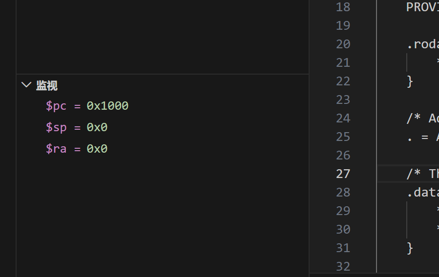

# 操作系统实验报告

## 实验基本信息

| 项目 | 内容                         |
|------|----------------------------|
| **实验名称** | Lab 1: [实验名称]              |
| **小组成员** | 学号1-姓名1、2411584-马锐、学号3-姓名3 |
| **完成日期** | YYYY-MM-DD                 |

### 小组分工

练习如何分工？

| 成员 | 负责的练习/模块   |
|------|------------|
| 学号1-姓名1 | [练习或模块名称]  |
| 学号2-姓名2 | 实验一自己学习和调试 |
| 学号3-姓名3 | [练习或模块名称]  |

实验报告如何分工？
暂时上传自己的部分
---

## 一、实验目的

<!-- 说明本次实验的主要目标和预期成果 -->

本实验的主要目的是：

1. [目的1：例如，理解用户态进程如何通过系统调用进入内核]
2. [目的2：例如，掌握进程创建、执行、退出的完整生命周期]
3. [目的3：例如，学习使用 AI 辅助开发操作系统核心功能]

---

## 二、实验环境

你们使用的 AI 工具

| 成员         | AI 编程工具                                                           | 底层模型                                                  | 备注 |
|------------|-------------------------------------------------------------------|-------------------------------------------------------|------|
| 学号1-姓名1    | [例如：Cline（VS Code插件） / Claude Code（终端 Agent） / DeepSeek Harness等] | [例如：Claude Sonnet 4.5 / GPT-5.5 / DeepSeek-V4-Flash等] | [可选：特殊配置等] |
| 2411584-马锐 | Codex & chatgpt vscode插件                                          | chatgpt 6.1sol                                        | |
| 学号3-姓名3    |                                                                   |                                                       | |

**说明：**
- **AI 编程工具**：指具体使用的终端工具、编辑器插件、桌面应用或浏览器界面
- **底层模型**：指该工具使用的大语言模型及版本

---

## 三、实验整体逻辑分析

### 2.1 本章节的逻辑主线
理解可执行内核和启动流程

### 2.2 功能的逐步实现


---

## 四、实验内容与实现

<!-- 
说明：本部分按照 exercises 文档中的练习顺序组织
每个功能模块或者练习中可能包含多项任务，请根据实际情况调整
-->

### 功能模块：[模块名称]

**负责人：** [学号-姓名]

#### 模块功能描述

**需要实现/修改的函数：**

```c
// 列出本模块涉及的所有函数签名
void example_function(void);
int another_function(int arg);
```

**功能说明：**

[简要描述该模块的功能，包括：
- 该模块在整个系统中的作用
- 需要处理的主要场景
- 与其他模块的交互关系]

#### 最终提示词

以下是经过迭代优化后，最终成功实现该功能的提示词：

````markdown

[按照提示词模板，给出具体的提示词]

````

#### 实现迭代过程

本模块的实现经历了 [N] 次迭代，过程如下：

---

##### 第一次迭代

如果设计的prompt生成代码后出现问题：

**遇到的问题：**
- 问题1：问题描述、错误信息和原因分析
- 问题2：问题描述、错误信息和原因分析

**问题解决策略：**
- 针对问题1：[说明如何修改提示词]
- 针对问题2：[说明如何修改提示词]

如果没有问题：

**最终结果：**

经过 [N] 次迭代，该模块最终：
- ✅ 编译通过
- ✅ 所有相关测试通过
- ✅ 功能符合预期

**关键改进点总结（如有）：**
1. [改进点1：例如，在 [RELY] 中补充了完整的系统调用号定义]
2. [改进点2：例如，在 [SPECIFICATION] 中明确了异常处理的边界条件]
3. [改进点3：例如，增加了对用户指针合法性检查的要求]

---

##### 第二次迭代（如有）

[按照和第一次迭代相同的格式]

---

##### 第三次迭代（如有）

[按照和第一次迭代相同的格式]

---

### 练习

**负责人：** [2411584 马锐]

[练习一，la是load address，加载地址，加载这个bootstacktop的地址。地址先放入寄存器sp中，目的是加载启动地址。tail kern_init一开始以为是返回，但实际上是尾调用，把函数交给另一个函数但不产生新的返回地址.作用是初始化，还有那个打印loading。初始化结束地址，然后系统停在while1无限循环]
[练习二，b *kern_entry
Note: breakpoint 1 also set at pc 0x80200000.
Breakpoint 2 at 0x80200000: file kern/init/entry.S, line 7.
> c
Continuing.

Breakpoint 1, kern_entry () at kern/init/entry.S:7
7	    la sp, bootstacktop
> info registers pc sp ra
pc             0x80200000	0x80200000 <kern_entry>
sp             0x8003def0	0x8003def0
ra             0x8000966a	0x8000966a
> x/4i $pc
=> 0x80200000 <kern_entry>:	auipc	sp,0x3
   0x80200004 <kern_entry+4>:	mv	sp,sp
   0x80200008 <kern_entry+8>:	j	0x8020000a <kern_init>
   0x8020000a <kern_init>:	auipc	a0,0x3
> p/x &bootstacktop
$1 = 0x80203000
> si
0x0000000080200004 in kern_entry () at kern/init/entry.S:7
7	    la sp, bootstacktop
> info registers pc sp
pc             0x80200004	0x80200004 <kern_entry+4>
sp             0x80203000	0x80203000 <SBI_CONSOLE_PUTCHAR>
>si
9	    tail kern_init
>info registers pc sp ra
pc             0x80200008	0x80200008 <kern_entry+8>
sp             0x80203000	0x80203000 <SBI_CONSOLE_PUTCHAR>
ra             0x8000966a	0x8000966a，

0x1000	auipc t0,0x0	将当前地址 0x1000 放入 t0，作为访问附近数据的基准
0x1004	addi a2,t0,40	将动态固件信息的地址 0x1028 放入 a2
0x1008	csrr a0,mhartid	将当前硬件线程编号放入 a0
0x100c	ld a1,32(t0)	从 0x1020 读取设备树的地址，放入 a1
0x1010	ld t0,24(t0)	从 0x1018 读取固件入口地址 0x80000000，放入 t0
0x1014	jr t0	跳转到 OpenSBI，其中auipc是立加数乘以4096，csrr是读取状态寄存器，mhartid是线程编号放入a0中，最初六条启动指令位于 0x1000、0x1004、0x1008、0x100c、
0x1010 和 0x1014，启动链条为：
QEMU 复位 ROM（0x1000） -> OpenSBI（0x80000000） -> uCore kern_entry（0x80200000）。]
---

### Challenge：[Challenge标题]

**负责人：** [学号-姓名]

[按照Challenge的具体要求进行解答]

---

## 五、测试与验证


**测试截图：**



---

## 六、实验总结与收获

### 对操作系统的理解

### AI 协作开发的经验


---

