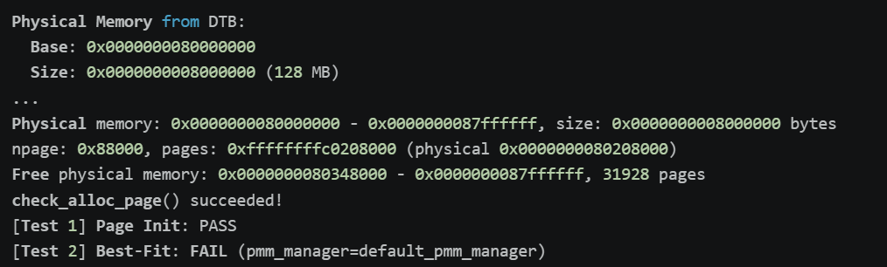
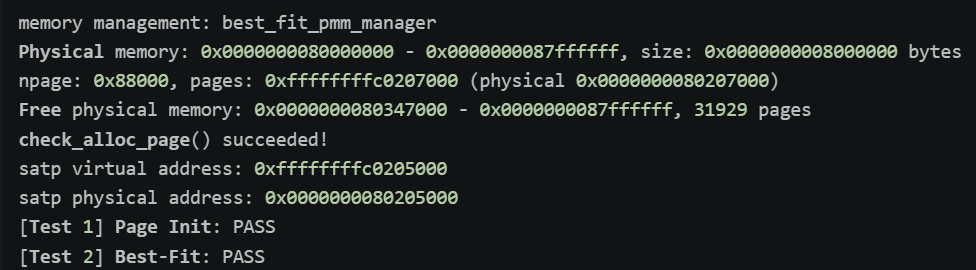
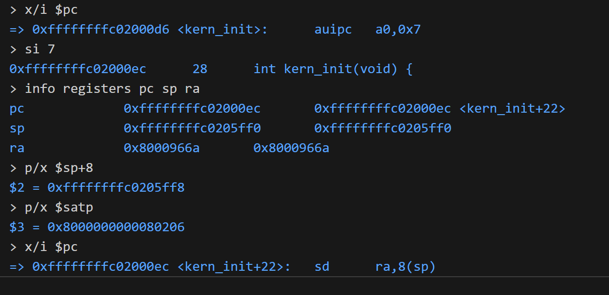
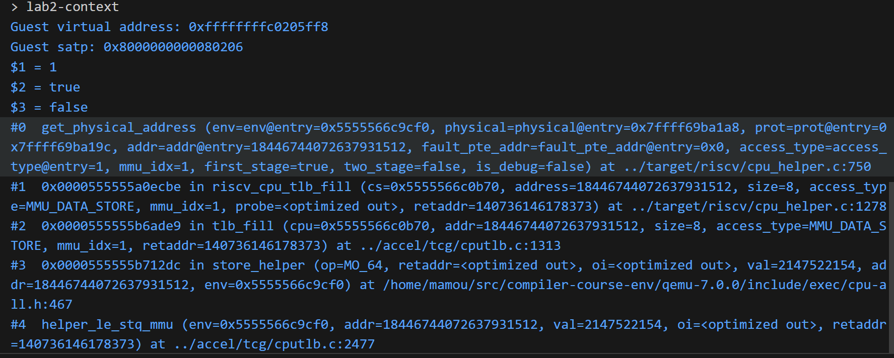
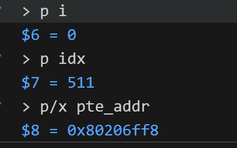
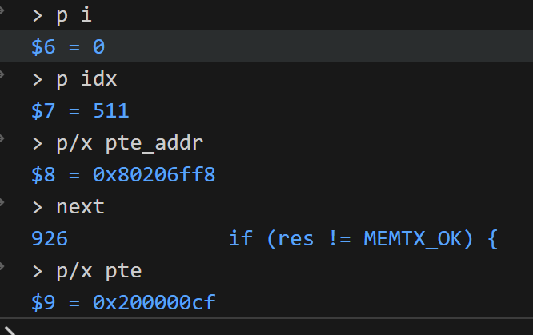
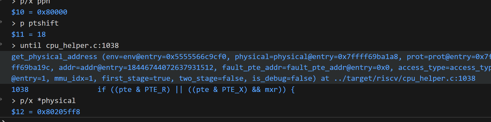
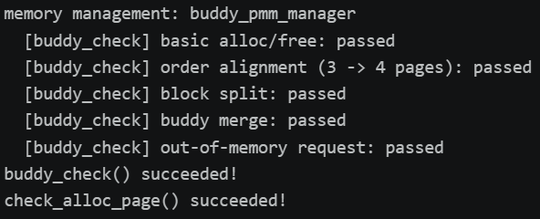
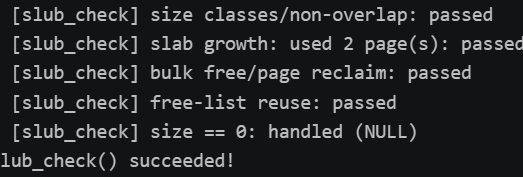

# 操作系统实验报告

## 实验基本信息

| 项目 | 内容 |
|------|------|
| **实验名称** | Lab 2: [物理内存和页表] |
| **小组成员** | 2411189-李梓宸、学号2-姓名2、学号3-姓名3 |
| **完成日期** | YYYY-MM-DD |

### 小组分工

练习如何分工？

| 成员 | 负责的练习/模块 |
|------|----------------|
| 学号1-姓名1 | [练习] |
| 学号2-姓名2 | [练习或模块名称] |
| 学号3-姓名3 | [练习或模块名称] |

实验报告如何分工？

---

## 一、实验目的

<!-- 说明本次实验的主要目标和预期成果 -->

本实验的主要目的是：

1. [目的1：例如，理解用户态进程如何通过系统调用进入内核]
2. [目的2：例如，掌握进程创建、执行、退出的完整生命周期]
3. [目的3：例如，学习使用 AI 辅助开发操作系统核心功能]

---

## 二、实验环境

你们使用的 AI 工具

| 成员 | AI 编程工具 | 底层模型 | 备注 |
|------|------------|---------|------|
| 学号1-姓名1 | [例如：Cline（VS Code插件） / Claude Code（终端 Agent） / DeepSeek Harness等] | [例如：Claude Sonnet 4.5 / GPT-5.5 / DeepSeek-V4-Flash等] | [可选：特殊配置等] |
| 学号2-姓名2 | | | |
| 学号3-姓名3 | | | |

**说明：**
- **AI 编程工具**：指具体使用的终端工具、编辑器插件、桌面应用或浏览器界面
- **底层模型**：指该工具使用的大语言模型及版本

---

## 三、实验整体逻辑分析

### 2.1 本章节的逻辑主线

[请用自己的话描述本章实验的核心主线，例如：
- 本章围绕哪个核心主题展开？（例如：用户进程管理、虚拟内存、文件系统等）
- 整个实验解决什么问题？（例如：如何让用户程序运行在操作系统之上）]

### 2.2 功能的逐步实现

[说明本章实验是按照什么顺序逐步实现各个功能的，以及为什么要按这个顺序，例如：

1. 首先实现**功能A** → 为什么首先实现这个？（例如：建立系统调用接口是后续所有用户态功能的基础）
2. 接着再完善**功能B** → 为什么接着实现这个？（例如：有了系统调用后，需要能够加载和启动第一个用户进程）
3. 然后完成**功能C** → 为什么然后实现这个？（例如：有了第一个进程后，需要实现进程复制功能）
4. 最后补充了**功能D** → 为什么最后实现这个？（例如：最后完善进程退出和清理机制，形成完整闭环）]

---

## 四、实验内容与实现

<!-- 
说明：本部分按照 exercises 文档中的练习顺序组织
每个功能模块或者练习中可能包含多项任务，请根据实际情况调整
-->

### 功能模块：[模块名称]

**负责人：** [学号-姓名]

#### 模块功能描述

**需要实现/修改的函数：**

```c
// 列出本模块涉及的所有函数签名
void example_function(void);
int another_function(int arg);
```

**功能说明：**

[简要描述该模块的功能，包括：
- 该模块在整个系统中的作用
- 需要处理的主要场景
- 与其他模块的交互关系]

#### 最终提示词

以下是经过迭代优化后，最终成功实现该功能的提示词：

````markdown

[按照提示词模板，给出具体的提示词]

````

#### 实现迭代过程

本模块的实现经历了 [N] 次迭代，过程如下：

---

##### 第一次迭代

如果设计的prompt生成代码后出现问题：

**遇到的问题：**
- 问题1：问题描述、错误信息和原因分析
- 问题2：问题描述、错误信息和原因分析

**问题解决策略：**
- 针对问题1：[说明如何修改提示词]
- 针对问题2：[说明如何修改提示词]

如果没有问题：

**最终结果：**

经过 [N] 次迭代，该模块最终：
- ✅ 编译通过
- ✅ 所有相关测试通过
- ✅ 功能符合预期

**关键改进点总结（如有）：**
1. [改进点1：例如，在 [RELY] 中补充了完整的系统调用号定义]
2. [改进点2：例如，在 [SPECIFICATION] 中明确了异常处理的边界条件]
3. [改进点3：例如，增加了对用户指针合法性检查的要求]

---

##### 第二次迭代（如有）

[按照和第一次迭代相同的格式]

---

##### 第三次迭代（如有）

[按照和第一次迭代相同的格式]

---

### 练习：[练习标题]

**负责人：** [2411189-李梓宸]

**任务一：实现物理内存探测与页描述符初始化功能（借助 AI 完成）**

**1. 实现思路**
通过借助 AI 辅助（Prompt 详见 `prompt.md`），在 `kern/mm/pmm.c` 的 `page_init()` 函数中完成了物理内存的探测与初始化。核心步骤如下：
- 调用 `get_memory_base()` 和 `get_memory_size()` 从设备树获取物理内存的起始地址和大小。
- 计算总物理页数 `npage`，并设置虚拟地址与物理地址的偏移量 `va_pa_offset`。
- 计算出 Page 描述符数组（`pages`）所需的空间，并确保它以及内核镜像（由链接符号 `end` 标记）和 OpenSBI 不会与空闲内存区域重叠。
- 找到第一个可用的完整物理页，将其转换为对应的 Page 指针后，调用 `init_memmap()` 将剩余可用物理内存注册到 `pmm_manager` 中。

**2. 测试结果**
运行 `make qemu` 后，内核成功启动并打印出探测到的物理内存范围。截图显示 `[Test 1] Page Init: PASS`，证明初始化逻辑正确。



#### 功能模块二：物理内存分配功能

**任务一：理解 First-Fit 连续物理内存分配算法**

**1. First-Fit 算法原理简述**
结合 `kern/mm/default_pmm.c` 中的源码，First-Fit 的核心机制如下：
- **初始化空闲页 (`default_init_memmap`)**：遍历传入的物理页，将页的 `ref` 和 `flags` 清零，设置 `property` 记录连续空闲页数，并按物理地址顺序将这些空闲块插入到全局双向链表 `free_list` 中。
- **分配连续物理页 (`default_alloc_pages`)**：从 `free_list` 的表头开始遍历，寻找第一个 `property >= n` 的空闲块。如果找到的块大于请求页数，则进行切割，将剩余部分重新设置为空闲块；将分配出的块从链表中删除，并更新 Page 状态。
- **回收与合并 (`default_free_pages`)**：释放页面时，清空页状态，更新 `property`，并将释放的块**按物理地址顺序**插入到 `free_list` 中。插入后，会检查该块与前、后物理地址相邻的块是否连续，如果连续则进行合并，更新合并后首页的 `property`，并从链表中删除多余的节点。

**2. 思考题：原有 First-Fit 算法是否有进一步的改进空间？**
有。First-Fit 算法在每次分配时都从链表头开始顺序查找，时间复杂度为 O(N)，效率较低。此外，它倾向于优先分配低地址的内存，容易导致低地址产生大量极小的外部碎片。改进方向包括：
- 引入 **Next-Fit** 算法，记录上一次查找结束的位置，下一次分配从该位置继续查找。
- 使用分离空闲链表（Segregated Free Lists）或平衡树（如红黑树）来管理空闲块，将查找时间复杂度降至 O(log N)。


**任务二：实现 Best-Fit 连续物理内存分配算法（借助 AI 完成）**

**1. 实现思路**
通过设计 Prompt（详见 `prompt.md`），让 AI 在 `kern/mm/best_fit_pmm.c` 中实现了 Best-Fit 算法，并在 `kern/mm/pmm.c` 的 `init_pmm_manager()` 中将管理器切换为 `best_fit_pmm_manager`。核心改动：
- **`alloc_pages`**：遍历 `free_list` 中的**所有**空闲块，记录满足 `property >= n` 且 `property` 最小的块。找到最匹配的块后执行切割和分配。
- **`free_pages`**：释放时，按物理地址顺序将新空闲块插入链表。然后通过检查 `page2pa` 计算地址连续性，如果与前后物理块连续，则进行 `merge` 合并。

**2. 测试结果**
运行测试后，成功打印 `memory management: best_fit_pmm_manager` 以及 `[Test 2] Best-Fit: PASS`。


**3. 思考题：你的 Best-Fit 算法是否有进一步的改进空间？**
有。Best-Fit 虽然能尽量保留大块连续内存，减少大块浪费，但其缺点在于每次分配都需要遍历整个空闲链表（O(N)），且容易产生大量极小的、无法再被利用的碎片（外部碎片）。改进方向：可以引入**分箱策略（Segregated Fit）**，按照内存块大小的 2 的幂次维护多个链表，这样查找时只需在相近大小的链表中寻找；或者采用**红黑树**来维护空闲块，实现 O(log N) 的查找与插入。


**任务三：Buddy System 实现与自测**

**负责人：** 2411584-马锐

**1. 实现与接入**

在完整工程 `code/lab2/kern/mm/buddy_pmm.c/.h` 中实现 Buddy，通过 `struct pmm_manager` 提供初始化、空闲区注册、分配、释放、空闲页统计和检查回调，并在 `pmm.c` 的 `init_pmm_manager()` 中选择 `buddy_pmm_manager`。公共 `Page` 结构、已有框架测试和评分脚本保持原样。

第 k 阶空闲链表管理 `2^k` 页的块。申请时将请求向上取整，例如申请 3 页实际取 4 页块；对应阶没有空闲块时，从更大的块逐级对半拆分。释放时根据物理页号与块页数异或计算伙伴，只有伙伴同阶、空闲且在合法范围内才合并，并继续尝试向上合并。初始空闲区按物理页号对齐拆分，因此起点不规整、总页数不是 2 的幂时也能保留可用页。

`Page.property` 在块首页记录实际块页数，只有空闲块首页设置 `PageProperty`。分配 3 页后仍可用原请求 `free_pages(base, 3)` 回收实际的 4 页。空闲页统计按实际块大小变化，失败请求返回 `NULL`。

**2. 提示词与自测设计**

本次分两步执行提示词：先实现并接入分配器，再单独扩展 `buddy_check()`，自测阶段不改分配算法。两份实际使用的提示词保存在 [prompt.md](prompt.md) 末尾的“Buddy System 实现与接入提示词”和“Buddy System 自测提示词”部分。

| 测试场景 | 检查内容与作用 |
|---|---|
| 1 页分配与释放 | 必须成功分配，空闲页数减少 1，释放后恢复，检查基础回调和计数。 |
| 3 页向上取整 | 实际减少 4 页，按原请求释放后恢复，检查分配大小与回收规则一致。 |
| 分裂与递归合并 | 从 16 页块分配小块，回收伙伴后重新申请完整 16 页块，验证拆分和向上合并。 |
| 相邻但非伙伴 | 4 页区域中释放第 1、2 页，虽然相邻但不能合成 2 页块；再释放真正的伙伴，才可重新得到大块。 |
| 分配失败 | 覆盖 0 页、超大请求、总页数不足、耗尽与碎片化，逐字段核对描述符、链表链接及空闲页计数，检查失败不会破坏状态。 |
| 多块并存与乱序释放 | 分配 1、8、4、2、1 页，逐对检查范围不重叠，乱序释放后恢复 16 页并重新分配整块。 |

确定性场景使用私有页描述符，暂存真实分配器的链表和全局描述符范围。所有测试分配释放完成后，恢复真实状态及原空闲页数，再输出成功；这样不会回收调用方正在使用的页面。上述测试分别从块大小、伙伴关系、状态保持和地址范围检查实现行为。

**3. 实际验证结果**

由助手在本机 WSL 执行 RISC-V 编译和独立验证：内核六类自测通过；宿主检查覆盖不规整初始区间、保留空洞、3000 次混合分配与释放，以及四类非法释放的独立负例；QEMU 的 32、64、96、128 MiB 四种配置均完成 Buddy 检查和框架分配检查。

```text
buddy_check: all 6 scenarios passed; allocator state restored.
buddy_check() succeeded!
check_alloc_page() succeeded!
```

原始输出见 [Buddy验证输出](Buddy验证输出.txt)，复现脚本为 `debug/check_buddy.py`。本次没有运行 `make grade`，上述结果不作为整组评分结果。

### Challenge：[Challenge标题]

**负责人：** [2411189-李梓宸]

### Challenge 1：硬件的可用物理内存范围的获取方法

**解答：**
如果操作系统无法提前获知硬件的可用物理内存范围，通常可通过以下几种机制让 OS 动态获取物理内存信息：
1. **BIOS 中断探测（e820）**：在 x86 架构的实模式下，操作系统在启动早期可以调用 BIOS 提供的 `INT 15H, EAX=E820H` 中断。BIOS 会返回一个物理地址映射表，明确告知 OS 哪些物理地址段是可用 RAM，哪些被硬件保留或占用。
2. **UEFI 内存映射表**：在现代 UEFI 引导模式下，UEFI 固件会在将控制权交接给 OS 时，通过 `GetMemoryMap()` 服务提供一份详细的内存描述符表，直接标出可用和保留的内存区域。
3. **直接内存探测（内存扫描/踩踏）**：在极简嵌入式环境中，OS 可以从一个安全的基准物理地址开始，按页递增尝试进行写入和读取操作。如果触发了总线错误或缺页异常，说明到达了物理内存的边界。
4. **ACPI 表解析**：从高级配置与电源接口（ACPI）提供的静态表中解析物理内存分布信息，获取地址空间的拓扑结构。


### Challenge 2：任意大小的内存单元 SLUB 分配算法

**1. 实现思路**
本模块通过从零设计，实现了两层架构的 SLUB 内存分配器：
- **第一层（页级）**：依赖于底层现有的物理内存管理器（如 Best-Fit）。当上层的对象缓存池为空时，向底层申请一页或多页连续的物理内存。
- **第二层（对象级）**：将申请到的一整页物理内存，根据用户请求的 `size` 进行对齐，切分成多个固定大小的对象（Object），并通过内部的空闲链表（Free-list）进行串联管理。本实现维护了多个固定大小的缓存池（如 8, 16, 32, 64, 128 字节等），提供了 `slub_alloc` 和 `slub_free` 接口。

**2. 提示词设计**
（完整 Prompt 内容详见 `prompt.md`）
- 第一份 Prompt（生成算法）：明确任务为“两层架构”，要求 AI 设计 `kmem_cache` 结构体维护空闲链表，并强调分配与释放时的安全性。
- 第二份 Prompt（生成测试）：要求 AI 编写 `slub_check()` 函数，强制要求覆盖不同大小对象的分配、跨页的多对象申请、释放后的内存复用、以及非法参数的边界防御。

**3. 测试覆盖与有效性说明**
通过运行内核测试，SLUB 模块的表现如下：
- **大小选择与地址对齐**：验证了不同尺寸的请求能被正确路由到对应的缓存池，且返回的指针符合对齐要求。
- **多页扩展（Slab Growth）**：通过批量申请大量小对象，验证了当单页容量耗尽时，底层能正确向系统申请新的页面。
- **内存复用与回收**：释放对象后再次申请同等大小对象，验证了系统会优先从空闲链表中返回刚被释放的地址，避免了底层物理页的频繁申请与泄露。
- **安全防御与边界**：测试了 `double-free`，系统成功拦截并报错，防止了链表损坏；对 `size == 0` 的请求安全返回了 `NULL`。

这些测试有效证明了：上层对象的切分与回收逻辑闭环、下层页的申请与归还联通正常，且具备一定的安全防御能力，完全符合 SLUB 的核心思想。

---

### 分支任务：GDB 调试页表查询过程

**负责人：** 2411584-马锐

首先在 `kern_init+22` 暂停，PC 为 `0xffffffffc02000ec`，选定的访存指令为 `sd ra,8(sp)`。此时 `sp = 0xffffffffc0205ff0`，因此目标虚拟地址为 `sp + 8 = 0xffffffffc0205ff8`，`satp = 0x8000000000080206`。图 1 记录该指令执行前的状态。



设置目标地址条件断点并单步执行该指令后，宿主 GDB 命中 `get_physical_address`。入口地址与图 1 的计算结果一致，`is_debug = false`，调用栈显示 `MMU_DATA_STORE` 和 `size = 8`，对应内核的真实 8 字节写访问。



继续运行到页表查询循环，实测 `base = 0x80206000`、`levels = 3`。首次查询时 `i = 0`，根页表索引为 `idx = 511`，PTE 的物理地址为 `0x80206ff8`，正好等于 `base + 511 * 8`，见图 3。



在 `cpu_helper.c:923` 执行一次 `next`，完成 `address_space_ldq(...)` 读取后，实测 `pte = 0x200000cf`，见图 4。低 8 位 `0xcf` 中 `V/R/W/X/A/D` 均为 1。



继续观察第 946 行的 `!(pte & (PTE_R | PTE_W | PTE_X))` 判断。本次 R/W/X 均为 1，条件为假，跳过查询下一级页表的分支，进入叶子项的合法性与权限检查，最终到达物理地址计算。实测 `ppn = 0x80000`、`ptshift = 18`，说明根级叶子采用 1 GiB 大页映射，实际只读取一级页表项。

手算物理地址：`ppn << 12 = 0x80000000`，虚拟地址低 30 位为 `0x205ff8`，两者相加得到 `0x80205ff8`。在地址赋值完成后的第 1038 行打印 `*physical`，QEMU 实际输出同为 `0x80205ff8`，见图 5，完成本次地址翻译核对。



调试过程中遇到客体 GDB 等待超时、选错线程栈帧导致局部参数不可见，以及控制台命令粘贴方式等问题。通过向助手提供实际输出，分别调整远程等待设置、切回正确栈帧及逐条输入命令后解决。具体情景与处理过程见下方调试记录。

详细过程见[页表调试记录](页表调试记录.md)。

---

## 五、测试与验证

<!-- 根据该实验的具体情况，提供完整的测试运行截图，应包含：
- 编译及运行成功的输出（make qemu），可能有多个
- 测试通过的结果（make grade），只有一个
-->

**测试截图：**




---

## 六、实验总结与收获

### 对操作系统的理解

1. 列出你们认为本实验中重要的知识点，以及与对应的 OS 原理中的知识点，并简要说明二者的含义、关系和差异
2. 列出你们认为 OS 原理中很重要、但在本实验中没有对应上的知识点

### AI 协作开发的经验

[写出你们在与 AI 协作过程中实际收获的经验或者感悟]

---

